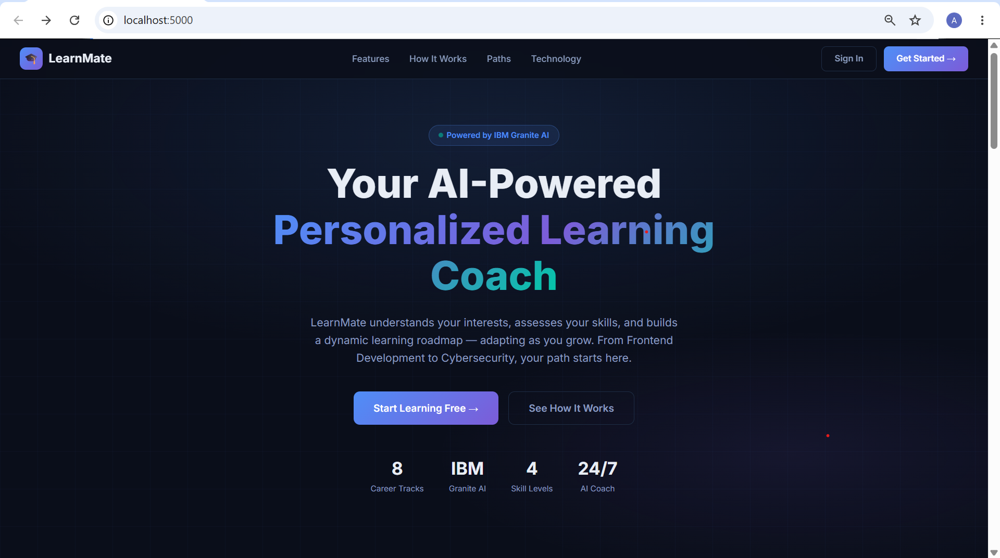
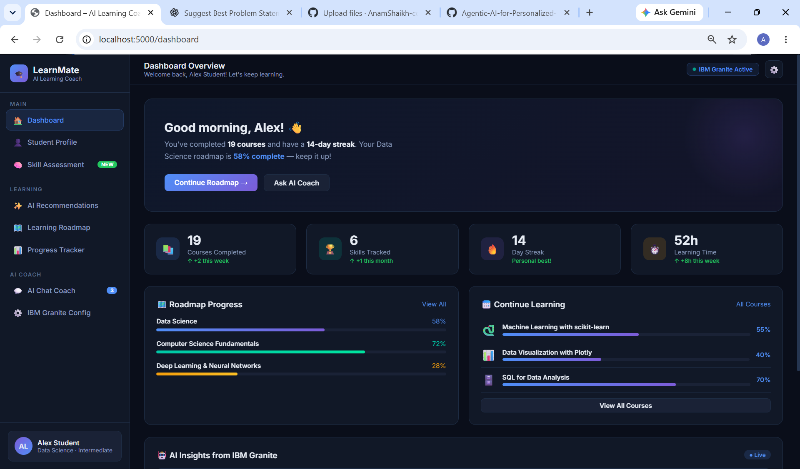
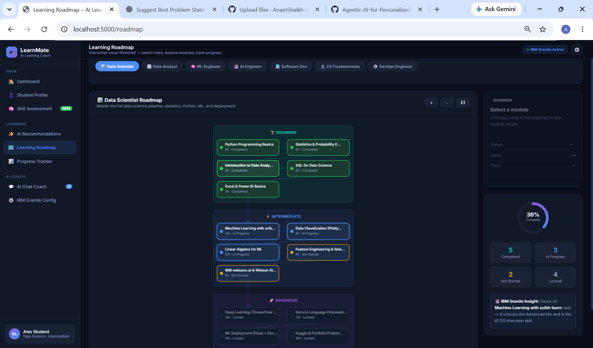
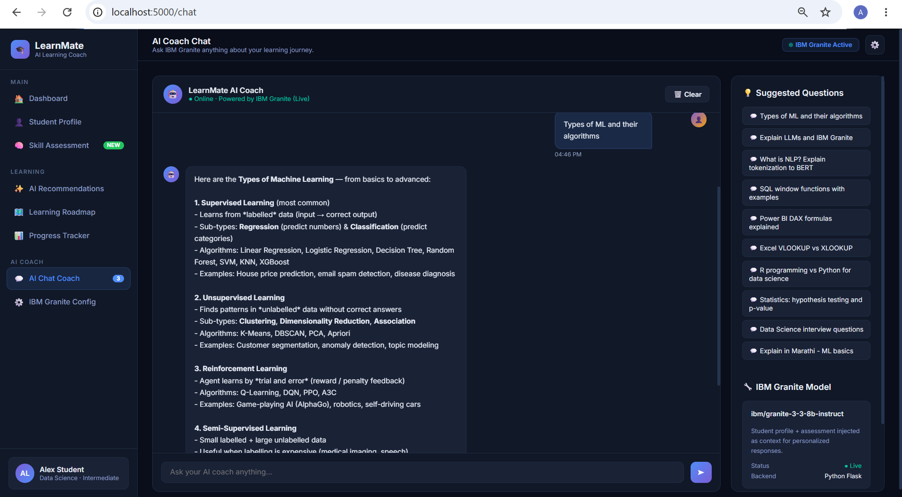

# 🎓 LearnMate — Agentic AI for Personalized Course Pathways

[](https://agentic-ai-for-personalized-course.onrender.com)
[](https://python.org)
[](https://flask.palletsprojects.com)
[](https://www.ibm.com/products/watsonx-ai)
[](LICENSE)

> An intelligent, personalized AI learning coach powered by **IBM Granite** on **watsonx.ai** — built with Python Flask.

---

## ✨ Features

| Feature | Description |
|---|---|
| 🤖 **AI Chat Coach** | Real-time answers powered by IBM Granite LLM |
| 📊 **Personalized Dashboard** | Track progress, streaks, XP, and skill levels |
| 🗺️ **Learning Roadmap** | 7 career tracks × 3 difficulty tiers |
| 📝 **Skill Assessment** | Auto-adjusts your level based on quiz results |
| 📚 **Course Recommendations** | Tailored to your current skills and goals |
| 📈 **Progress Tracker** | Milestones, completed courses, and badges |
| 👤 **Student Profile** | Customizable name, track, goals, and interests |
| 🌐 **Marathi Support** | Responses available in Marathi language |
| 🔒 **Secure by Default** | Credentials in env vars, never in code |

---

## 🚀 Live Demo

👉 **[https://agentic-ai-for-personalized-course.onrender.com](https://agentic-ai-for-personalized-course.onrender.com)**

> The app runs in **Demo mode** without IBM credentials (full knowledge base still works).  
> Add your IBM Granite API key in the **Config** page to enable live AI responses.

---

## 📸 Screenshots

| Landing Page | Dashboard |
|---|---|
|  |  |

| Learning Roadmap | AI Chat Coach |
|---|---|
|  |  |

---

## 🛠️ Tech Stack

- **Backend:** Python 3.13, Flask 3.0
- **AI:** IBM Granite 3.3 8B Instruct via `ibm-watsonx-ai` SDK
- **Frontend:** Vanilla HTML/CSS/JS (no framework)
- **Deployment:** Render (gunicorn)
- **Secrets:** Environment variables via `python-dotenv`

---

## ⚙️ Local Setup

### 1. Clone the repository
```bash
git clone https://github.com/AnamShaikh-code/Agentic-AI-for-Personalized-Course-Pathway.git
cd Agentic-AI-for-Personalized-Course-Pathway
```

### 2. Create a virtual environment
```bash
python -m venv venv
venv\Scripts\activate        # Windows
# source venv/bin/activate   # Mac/Linux
```

### 3. Install dependencies
```bash
pip install -r requirements.txt
```

### 4. Set up environment variables
```bash
copy .env.example .env       # Windows
# cp .env.example .env       # Mac/Linux
```
Then open `.env` and fill in your credentials:
```env
SECRET_KEY=your-random-secret-key
IBM_API_KEY=your-ibm-cloud-api-key
IBM_PROJECT_ID=your-watsonx-project-id
```
> Generate a strong SECRET_KEY:
> ```bash
> python -c "import secrets; print(secrets.token_hex(32))"
> ```

### 5. Run the app
```bash
python app.py
```
Open **[http://127.0.0.1:5000](http://127.0.0.1:5000)** in your browser.

---

## 🔑 Getting IBM Granite API Credentials (Free)

1. Sign up at **[cloud.ibm.com](https://cloud.ibm.com)** (no credit card needed)
2. Go to **Manage → Access (IAM) → API Keys → Create** → copy your `IBM_API_KEY`
3. Go to **[watsonx.ai](https://dataplatform.cloud.ibm.com/wx/home)** → Create a project → copy your `IBM_PROJECT_ID`
4. Enter both in the app's **Config** page or in your `.env` file

---

## 📁 Project Structure

```
learnmate-flask/
├── app.py                  # Flask app — routes, AI logic, knowledge base
├── requirements.txt        # Python dependencies
├── render.yaml             # Render deployment config
├── .env.example            # Environment variable template
├── .gitignore              # Excludes .env and cache files
└── templates/
    ├── base.html           # Shared layout & navigation
    ├── index.html          # Landing page
    ├── dashboard.html      # Student dashboard
    ├── chat.html           # AI chat interface
    ├── config.html         # IBM Granite configuration
    ├── profile.html        # Student profile editor
    ├── assessment.html     # Skill assessment quiz
    ├── recommendations.html # Course recommendations
    ├── roadmap.html        # Learning roadmap
    └── progress.html       # Progress tracker
```

## 🔒 Security

- All credentials are stored in **environment variables** — never hardcoded
- Session cookies are `HttpOnly`, `SameSite=Lax`, and `Secure` (HTTPS)
- `.env` is excluded from Git via `.gitignore`
- IBM API keys entered in the UI are stored in server-side Flask sessions only

---

## 📄 License

This project is licensed under the **MIT License** — see [LICENSE](LICENSE) for details.

---
## 👩‍💻 Developed By

## Anam Shaikh

<div align="center">
  Built with Deligence using IBM Granite &amp; Flask &nbsp;|&nbsp; Problem Statement #12
</div>
